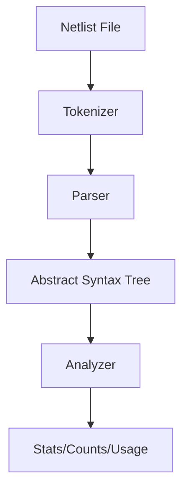

# Netlist Parser Architecture

This document outlines the internal architecture and design of the `netlist_parser` utility. The tool is designed to parse SPICE-like netlists (including CDL dialects), represent them in an Abstract Syntax Tree (AST), and perform static analysis such as flattening and component counting.

## 1. High-Level Architecture

The system is composed of three main layers:
1.  **Parser Layer**: Converts raw text into an AST.
2.  **AST Layer**: Strong Python object representation of the circuit.
3.  **Analyzer Layer**: Algorithms for inspecting, traversing, and flattening the AST.

## 2. Core Components

### 2.1 Parsing Engine (`netlist_parser/parser/`)

The parsing logic is separated into tokenization and semantic parsing.

*   **`SpiceTokenizer`**: 
    *   Handles line continuations (`+`).
    *   Strips comments:
        *   Standard SPICE: `*` at the start of a line.
        *   Inline comments: a bare `$` followed by whitespace (CDL style). Attached tokens like `$SUB=VSS` or `$[model]` are *not* comments and survive tokenization.
    *   Yields "logical lines" for the parser to process.

*   **`SpiceParser`**:
    *   Implements the core parsing loop.
    *   **Scope Management**: Maintains a stack of scopes (Main Circuit -> Subckt -> Nested Subckt) to correctly place components.
    *   **Dialect Handling**:
        *   **Standard SPICE**: `Xname node1 ... subckt_name`
        *   **CDL**: `Xname node1 ... / subckt_name params...`. The parser specifically detects the `/` token to correctly identify the subcircuit name in CDL netlists.
        *   **CDL Comment-Coded Parameters** (`_extract_cdl_tokens`): before element parsing, `$`-prefixed tokens are separated out: `$[name]` supplies the device model (common for resistors, e.g. `RR1 N1 N2 $SUB=VSS $[opppcres] w=1u`), `$KEY=value` becomes a parameter, and any other `$token` starts an inline comment (rest of line dropped).
    *   **Case Handling**: element-type dispatch is case-insensitive, but component names retain their source case (`Xtop` stays `Xtop`).

### 2.2 Abstract Syntax Tree (`netlist_parser/ast.py`)

The AST is a hierarchy of Python dataclasses representing the circuit structure.

*   **`Circuit`**: The root object. Contains a list of global `Component`s, `Subckt` definitions, and `Model` definitions.
*   **`Subckt`**: Represents a `.SUBCKT` definition. Has `ports` (interface) and internal `components`.
*   **`Component`**: Abstract base class.
    *   **`SubcktInstance` (`X`)**: Represents an instantiation of a subcircuit. Stores `nodes` (connections) and `subckt_name` (reference).
    *   **`Mosfet` (`M`)**, **`Resistor` (`R`)**, **`Capacitor` (`C`)**, etc.: Primitive devices with specific attributes (nodes, value, model).

### 2.3 Analyzer (`netlist_parser/analyzer.py`)

The analyzer performs heavy lifting on the AST.

*   **`NetlistAnalyzer`**: The main interface for analysis. Builds a `name -> Subckt` dictionary once at construction; all definition lookups (flattening, classification, top-cell search) are O(1) instead of scanning the subcircuit list.
*   **Top Cell Detection**:
    *   **Manual**: User supplies `--top-cell`.
    *   **Auto-detect (`find_top_cell`)**: Heuristic that looks for subcircuits that are *defined* but never *instantiated* by any other subcircuit.
*   **Flattening Engine (`flatten`)**:
    *   Recursively traverses `SubcktInstance` nodes, threading a per-level port map (subckt port -> resolved parent net) through the recursion.
    *   **Node Renaming**: Generates unique hierarchical names (e.g., `X1.X2.M1`) to resolve scope.
    *   **Node Mapping**: Maps internal subcircuit ports to parent nets via the port map; internal nets are prefixed with the instance path.
    *   **Copy Discipline**: Emits exactly one shallow copy per flattened primitive (with new `name` and `nodes`); subcircuit definitions are never copied or mutated. Flattened components share their `parameters` dict with the source AST, so analyses must treat them as read-only.
    *   **Unresolved Handling**: If a subcircuit definition (e.g., standard cell) is missing (missing `.INCLUDE`), the analyzer tracks it in `unresolved_subckts` and treats the instance as a black box to prevent crashes.
*   **Duplicate Subcircuit Check (`get_duplicate_subckts`)**: Groups subcircuit definitions by name (case-insensitive unless the analyzer is created with `case_sensitive=True`) and reports any name defined more than once, with each definition's source file and line (recorded by the parser on `.SUBCKT`). Definitions are compared by ports, parameters and components, ignoring source location, to label a duplicate as identical or conflicting. The last definition is the one the analyzer uses.
*   **Recursion Check (`find_recursive_subckts`)**: Depth-first search over the subcircuit graph that reports definitions lying on an instantiation cycle. `flatten()` and `print_hierarchy()` track the subcircuits on the current path and stop expanding when one repeats.
*   **Model Extraction (`get_all_models`)**: Scans all subcircuit definitions and top-level components without flattening. Besides modeled primitives (M/Q/D/R/C/L), instances of *empty or undefined* subcircuits are counted as devices — CDL netlists commonly instantiate PDK primitives as X-elements of leaf cells (e.g. `XM1 d g s b pmos_1p5 W=1u L=0.2u`).

### 2.4 Duplicate Removal (`netlist_parser/dedupe.py`)

Backs the `--remove-duplicates OUTPUT` option. It works on the source text rather than re-emitting the AST, so everything outside the removed blocks is preserved byte-for-byte.

*   **`remove_duplicate_subckts`**: Uses `get_duplicate_subckts()` and each definition's recorded source line to cut redundant `.SUBCKT ... .ENDS` blocks (nesting-aware, including `+` continuations) out of the top-level file. Identical duplicates are always reduced to one copy (a copy in an included file is preferred, since included files are never rewritten). Conflicting duplicates are left alone and reported unless `--keep first|last` is given.
*   **`verify_dedupe`**: Re-parses the cleaned text and checks that the set of subcircuit names and the component counts are consistent with the original before anything is written.
*   **CLI safety**: The input file is never modified and an existing output file is never overwritten.

## 3. Key Data Flows

### 3.1 flattening Algorithm
Flattening is essential for accurate transistor counts in hierarchical designs.

1.  Start at the **Root** (Top Cell).
2.  Iterate through components:
    *   If **Primitive** (M, R, C): Clone it, prefix its name with the current path (`path.name`), and add to the flat circuit.
    *   If **Instance** (X):
        1.  Look up the `Subckt` definition by name.
        2.  If not found -> Mark as **Unresolved** (Warning).
        3.  If found -> Create a **Port Map** (Subckt Port -> Instance Node).
        4.  Recursively call `flatten` on the Subckt's contents, passing the updated path (`path.instance_name`) and the Port Map.
        5.  Inside specific recursion: Internal nodes are prefixed; Ports are replaced by the parent's net name (from Port Map).

### 3.2 Model Usage Analysis
1.  Flatten the circuit first.
2.  Iterate through all primitives in the flat list.
3.  Accumulate counts of the `model` attribute (e.g., `nmos`, `pmos`).

## 4. Design Decisions & Trade-offs

*   **Custom Parser vs. Library**: A custom parser was chosen to support CDL-specific features (like `/` separators and `$` comments) that strict SPICE parsers often fail on.
*   **Static Analysis Focus**: The tool does not evaluate parameters (e.g., `W=1u+2u`) mathematically. It treats them as strings. This simplifies the architecture for the goal of connectivity and count analysis without needing a full SPICE simulation engine.
*   **Error Tolerance**: The decision to warn (and continue) on missing subcircuits rather than crash allows the tool to be useful on partial netlists or when standard cell libraries are not available.
*   **Performance**: Flattening avoids deep copies and linear definition lookups (dict lookup + one shallow copy per emitted component). A 75MB / 1.17M-line CDL netlist with ~10k subcircuits parses in ~10s and flattens in ~4s. The trade-off is that flattened components share parameter dicts with the AST and must not be mutated in place.
